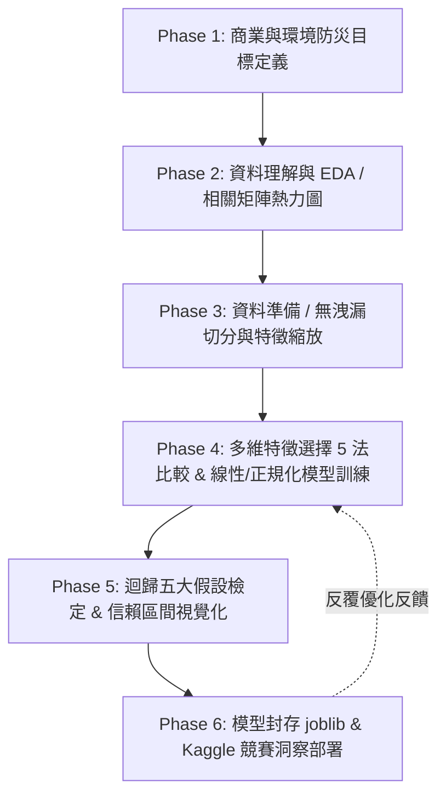

# 🌊 基於 CRISP-DM 架構與多維特徵選擇之洪災機率預測 (Flood Prediction)

[](https://www.python.org/)
[]()
[](https://scikit-learn.org/)
[]()

> 本專案為資料科學與物聯網/環境數據分析專題，採用業界標準 **CRISP-DM（跨行業資料採礦標準流程）** 六大生命週期階段，針對 Kaggle 競賽 [Predict the Flood Probability](https://www.kaggle.com/competitions/predictheflood/data) 進行高精度連續型洪災機率預測。透過 5 種嚴謹的特徵選擇技術消除雜訊與多重共線性，並對線性迴歸模型進行完整嚴密的**統計五大假設檢定**與信賴區間視覺化。

---

## 📑 目錄 (Table of Contents)
- [專案簡介與架構](#-專案簡介與架構)
- [資料集說明與特徵字典](#-資料集說明與特徵字典)
- [CRISP-DM 六大實作階段](#-crisp-dm-六大實作階段)
  - [Phase 1: Business Understanding (商業理解)](#phase-1-business-understanding-商業理解)
  - [Phase 2: Data Understanding (資料理解)](#phase-2-data-understanding-資料理解)
  - [Phase 3: Data Preparation (資料準備)](#phase-3-data-preparation-資料準備)
  - [Phase 4: Modeling & Feature Selection (模型建構與特徵選擇)](#phase-4-modeling--feature-selection-模型建構與特徵選擇)
  - [Phase 5: Model Evaluation & Statistical Diagnostics (模型評估與假設檢定)](#phase-5-model-evaluation--statistical-diagnostics-模型評估與假設檢定)
  - [Phase 6: Deployment & Kaggle Summary (模型部署與成果展現)](#phase-6-deployment--kaggle-summary-模型部署與成果展現)
- [專案目錄結構](#-專案目錄結構)
- [環境安裝與快速開始](#-環境安裝與快速開始)
- [核心技術與評估指標](#-核心技術與評估指標)
- [授權與聯絡資訊](#-授權與聯絡資訊)

---

## 🧭 專案簡介與架構

洪澇災害是全球氣候變遷下最致命且經濟損失最慘重的自然災害之一。傳統水文物理模擬（如 2D 水理計算）耗時耗能且難以在大尺度下即時反應。本專案透過大數據與統計機器學習技術，建構**可解釋性高、推論極速且符合統計學檢驗**的洪災風險預測框架。



---

## 📊 資料集說明與特徵字典

- **資料來源**：[Kaggle: Predict the Flood Probability Data](https://www.kaggle.com/competitions/predictheflood/data)
- **預測目標 (Target)**：`FloodProbability`（連續型數值，數值介於 0.0 ~ 1.0 之間，代表該地理網格發生洪災的機率）
- **環境與地理因子**：共 20 項標準化指標特徵

| 編號 | 特徵名稱 (Feature Name) | 物理/環境意涵 | 影響面向 |
| :---: | :--- | :--- | :---: |
| 1 | `MonsoonIntensity` | 季風強度與短期極端降水集中度 | 氣象因子 |
| 2 | `TopographyDrainage` | 地形天然坡度與重力排水效率 | 地形水文 |
| 3 | `RiverManagement` | 河川疏濬、截彎取直與防洪工程完整度 | 水利工程 |
| 4 | `Deforestation` | 森林砍伐率（降低水土保持與土壤涵水能力） | 生態環境 |
| 5 | `Urbanization` | 都市化比例（不透水鋪面增加，地表逕流暴增） | 都市規劃 |
| 6 | `ClimateChange` | 長期氣候極端事件變異性指標 | 氣象因子 |
| 7 | `DamsQuality` | 水壩防洪蓄洪能力與結構安全評分 | 水利工程 |
| 8 | `Siltation` | 水庫與河床泥沙淤積嚴重程度 | 地理水文 |
| 9 | `AgriculturalPractices` | 農業耕作方式與梯田/水田水土保持效益 | 土地利用 |
| 10 | `Encroachments` | 行水區違法佔用與河道違章阻礙通水程度 | 人為干預 |
| 11 | `DrainageSystems` | 人工雨水下水道與側溝設施覆蓋率 | 都市防洪 |
| 12 | `CoastalVulnerability` | 暴潮、海平面上升與海岸侵蝕脆弱度 | 海洋環境 |
| 13 | `Landslides` | 順向坡滑動與土石流阻塞河道潛勢 | 地質災害 |
| 14 | `Watersheds` | 集水區健康指標與天然緩衝蓄洪能力 | 地理水文 |
| 15 | `DeterioratingInfrastructure`| 老舊水利結構與防洪抽水站失修程度 | 基礎設施 |
| 16 | `PopulationScore` | 洪災高風險區常住人口密度加權分數 | 社會脆弱度 |
| 17 | `WetlandLoss` | 天然濕地/滯洪池流失與萎縮比例 | 生態緩衝 |
| 18 | `InadequatePlanning` | 土地利用分區不當與缺乏排洪考量之規劃 | 治理與政策 |
| 19 | `PoliticalFactors` | 防災預算落實度、跨部門協調與法規監管 | 治理與政策 |
| 20 | `IneffectiveDisasterPreparedness`| 預警疏散機制與救災物資整備之不足程度 | 應變能力 |

---

## 🔬 CRISP-DM 六大實作階段

### Phase 1: Business Understanding (商業理解)
1. **任務定性**：連續型迴歸任務（Continuous Regression Task），以最小化預測殘差、提升整體解釋力（$R^2$）為準繩。
2. **決策價值與應用場景**：
   - **防汛資源精準調度**：於汛期前數週提早鎖定極端高風險區塊，優先部署大型移動式抽水機與砂包儲備。
   - **都市更新與國土規劃**：量化各項人為因子（如透水鋪面補強、行水區違建拆遷）對洪災機率的改善彈性（Elasticity），輔助政府評估防洪公共工程投資報酬率。

### Phase 2: Data Understanding (資料理解)
- **資料檢驗**：讀取 `train.csv`，檢驗維度結構（Shape）、特徵資料型態（Data Types）與檢查缺失值分佈。
- **相關係數矩陣 (Correlation Heatmap)**：
  - 採用 Pearson 相關係數繪製高解析度熱力圖。
  - 觀察各因子與目標變數 `FloodProbability` 的關聯強度，並檢視各特徵對之間是否存在初步共線性跡象。

### Phase 3: Data Preparation (資料準備)
- **嚴防資料洩漏 (Data Leakage Free Pipeline)**：
  - 切分 80% 訓練集 (`X_train, y_train`) 與 20% 測試集 (`X_test, y_test`)，嚴格固定 `random_state=42`。
- **資料預處理與縮放**：
  - 缺失值中位數填補（若存在）。
  - 使用 `StandardScaler` 對連續特徵進行 Z-Score 標準化：
    $$z = \frac{x - \mu}{\sigma}$$
  - **重要準則**：僅在訓練集擬合（`fit_transform`），測試集僅使用訓練集統計量進行轉換（`transform`）。

### Phase 4: Modeling & Feature Selection (模型建構與特徵選擇)
為兼顧模型精準度與精簡度，本階段綜合比較 **5 種主流特徵選擇方法**（皆僅使用 Training Data 計算）：
1. **`SelectKBest`**：基於 F-regression 統計檢定分數排序。
2. **`RFE` (遞歸特徵消除)**：透過線性核逐步淘汰權重最小之特徵。
3. **`Sequential Feature Selection (SFS)`**：前向/後向貪婪搜尋最佳特徵子集。
4. **`Lasso (L1 Regularization)`**：利用 L1 罰項將次要特徵係數直接壓縮至 0，形成稀疏特徵解。
5. **`Permutation Importance`**：排列隨機化後驗證驗證集指標下降幅度，衡量真實泛化貢獻。

**候選迴歸模型實作**：
- **標準多元線性迴歸 (Ordinary Least Squares, OLS)**
- **Ridge 迴歸 (L2 嶺迴歸)**：$\min_\beta \|y - X\beta\|_2^2 + \alpha \|\beta\|_2^2$
- **Lasso 迴歸 (L1 迴歸)**：$\min_\beta \frac{1}{2n}\|y - X\beta\|_2^2 + \alpha \|\beta\|_1$

### Phase 5: Model Evaluation & Statistical Diagnostics (模型評估與假設檢定)

#### 1. 綜合效能指標
計算測試集上各模型之：
- **MAE** (Mean Absolute Error)
- **MSE** (Mean Squared Error)
- **RMSE** (Root Mean Squared Error)
- **$R^2$** (決定係數)
- **Adjusted $R^2$** (調整後決定係數)：
  $$R_{adj}^2 = 1 - \left[ \frac{(1 - R^2)(n - 1)}{n - k - 1} \right]$$

#### 2. 嚴格驗證迴歸五大統計假設
| 假設項目 | 檢驗方法 | 判讀與合格標準 |
| :--- | :--- | :--- |
| **1. 線性關係 (Linearity)** | 殘差對預測值散布圖 (Residuals vs Fitted) | 殘差應均勻對稱散布於 0 軸兩側，無明顯 U 型或非線性趨勢 |
| **2. 殘差常態性 (Normality)** | Q-Q Plot (Quantile-Quantile) & Shapiro-Wilk 檢定 | 點應緊貼 45 度對角理論線，$p > 0.05$ |
| **3. 同變異性 (Homoscedasticity)** | Scale-Location 圖 / Breusch-Pagan 檢定 | 殘差變異數不隨預測值擴大，點群寬度維持一致 |
| **4. 誤差獨立性 (Independence)** | Durbin-Watson (DW) 統計量檢定 | $DW \approx 2.0$（一般介於 1.5 ~ 2.5 視為無自相關） |
| **5. 無多重共線性 (No Multicollinearity)** | 變異數膨脹因子 (Variance Inflation Factor, VIF) | 各自變數之 $\text{VIF} < 5$（嚴格標準）或 $< 10$ |

#### 3. 視覺化展示
- 真實值 vs. 預測值對比散布圖。
- 繪製 **95% 信賴區間 (Confidence Interval, CI)** 與 **預測區間 (Prediction Interval, PI)**，展現出版等級的美感與統計說服力。

### Phase 6: Deployment & Kaggle Summary (模型部署與成果展現)
1. **模型封存與生產端推論**：
   - 使用 `joblib.dump()` 將訓練完成之 Scaler 與最佳 Ridge/Linear 模型固化為 `.pkl`。
   - 封裝高健壯性推論函式 `predict_flood_probability(new_df)`，自動校驗輸入格式並輸出機率預測。
2. **Kaggle 級別成果洞察**：
   - 評估在 Kaggle Leaderboard 上的競爭力排名水準。
   - 針對貢獻度前幾名的環境特徵（如 `MonsoonIntensity`、`TopographyDrainage`、`RiverManagement`）提出物理機理與實際防汛建議。

---

## 📂 專案目錄結構

```text
IoT_HW2/
│
├── README.md                          # 專案完整說明文件 (即本文件)
├── requirements.txt                   # 專案相依 Python 套件清單
│
├── data/                              # 資料儲存目錄 (請置放 Kaggle 資料)
│   ├── train.csv                      # 訓練資料集
│   └── test.csv                       # 測試資料集
│
├── notebooks/                         # 互動式分析與視覺化實驗
│   └── flood_prediction_crispdm.ipynb # 完整實作 Jupyter Notebook
│
├── src/                               # 模組化核心原始碼
│   ├── __init__.py
│   ├── data_loader.py                 # 資料讀取與統計摘要
│   ├── preprocessor.py                # 資料前處理、標準化與資料洩漏防護
│   ├── feature_selection.py           # 5 大特徵選擇演算法實作
│   ├── models.py                      # 迴歸模型建構與超參數調校
│   ├── diagnostics.py                 # 迴歸五大假設檢定與統計檢驗
│   ├── visualizer.py                  # 出版級高質感圖表繪製器 (Seaborn/Matplotlib)
│   └── inference.py                   # 封裝模型載入與新樣本推論介面
│
├── models/                            # 儲存訓練完成之模型與轉換器
│   ├── best_flood_model.pkl           # 最佳預測模型權重
│   └── standard_scaler.pkl            # 特徵標準化轉換器
│
└── reports/                           # 產出之圖表與分析報告
    └── figures/                       # 熱力圖、假設檢定圖與預測區間圖
```

---

## 🛠️ 環境安裝與快速開始

### 1. 建立並啟動虛擬環境 (建議)
```bash
# 使用 venv 建立環境
python -m venv venv

# Windows 啟動虛擬環境
.\venv\Scripts\activate

# macOS / Linux 啟動虛擬環境
source venv/bin/activate
```

### 2. 安裝必要相依套件
```bash
pip install -r requirements.txt
```

### 3. 下載 Kaggle 資料集
至 [Kaggle: Predict the Flood Probability](https://www.kaggle.com/competitions/predictheflood/data) 下載 `train.csv` 與 `test.csv`，並放置於 `data/` 目錄下。

### 4. 執行互動式 Notebook 或 Pipeline
```bash
# 啟動 Jupyter Notebook 進行逐步分析
jupyter notebook notebooks/flood_prediction_crispdm.ipynb
```

---

## 📦 核心技術與依賴套件

本專案依賴以下經過驗證的 Python 資料科學主流套件（詳見 `requirements.txt`）：

- **資料處理與計算**：`pandas`, `numpy`
- **統計建模與機器學習**：`scikit-learn`, `statsmodels`, `scipy`
- **數據視覺化**：`matplotlib`, `seaborn`
- **模型序列化與部署**：`joblib`
- **開發環境**：`jupyter`, `ipykernel`

---

## 📜 授權條款 (License)

本專案依據 [MIT 授權條款](LICENSE) 開源發布，歡迎學術研究、教學與工程實務交流與改進。
