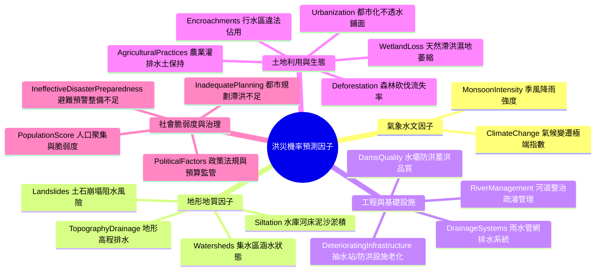

# Phase 1: Business Understanding (商業理解與專案目標定義)

---

## 1. 專案背景與環境脈絡 (Context & Background)

氣候變遷引發的極端天氣事件（如短延時強降雨、滯留鋒面與強烈季風）正以更高頻率衝擊全球城鄉聚落。傳統水利防洪工程通常依賴水文物理模型（如一維/二維淺水波數值模擬，如 HEC-RAS、SWMM），雖然機理精確，但面臨三大瓶頸：
1. **運算耗時漫長**：在大尺度網格化水理計算中，無法滿足緊急防汛的即時（Real-time）決策反應需求。
2. **參數門檻極高**：高度仰賴高解析度數值高程模型（DEM）、管網測繪與粗糙度係數，在開發中國家或大範圍流域常有資料缺失。
3. **多維人為因子難以定量**：如違章侵佔行水區、排水維護落後、土地利用無序等人文治理因子，極難融入傳統物理水文方程。

因此，本專案導入資料科學與現代統計機器學習技術，基於 Kaggle [Predict the Flood Probability](https://www.kaggle.com/competitions/predictheflood/data) 資料集，利用 20 項涵蓋氣象、地形、水利、生態與人為治理特徵，建立高精度、秒級推論且具備高度統計可解釋性的洪災機率預測系統。

---

## 2. 機器學習任務定性 (Task Formulation)

- **任務類別**：**連續型多元迴歸預測 (Continuous Multivariate Regression)**。
- **目標變數 (Target Variable)**：`FloodProbability`
  - 數值分佈：連續型實數，範圍落在 $[0.0, 1.0]$。
  - 統計意涵：代表特定地理網格（Spatial Grid / Basin Unit）在給定環境與管理條件下，遭遇溢堤或積淹水成災的機率預期值。
  - 損失函數（Loss Function）：以均方誤差（Mean Squared Error, MSE）及均方根誤差（RMSE）為優化基準，兼顧平均絕對誤差（MAE）。
- **特徵空間 (Feature Space)**：
  - 共 20 項多維環境因子（包含氣象因子、水理工程、土地利用、基礎設施及社會治理面向）。

---

## 3. 特徵物理意涵與領域知識解析 (Domain Knowledge & Environmental Factors)

針對資料集包含的 20 項連續特徵因子，本專案將其歸納為五大維度：

### 3.1 氣象與地形自然驅動因子
1. **`MonsoonIntensity` (季風強度)**：直接決定入滲過飽和後的產流總量（Runoff volume），為致災最直接的外在強迫力（External Forcing）。
2. **`TopographyDrainage` (地形天然坡度與排水力)**：地表坡度與微地形坡降，直接主導地表逕流流速與窪地積水時間。
3. **`Landslides` (土石崩塌風險)**：山崩與土石流易造成堰塞湖或堵塞下游過水斷面，引發連鎖潰壩與漫淹。
4. **`Watersheds` (集水區涵水狀況)**：源頭集水區涵養水源的能力與植被被覆狀態。
5. **`Siltation` (河道泥沙淤積)**：長年淤砂抬高通水底床，縮減過水斷面通洪容量。

### 3.2 灰色工程與基礎設施因子
6. **`DamsQuality` (水壩結構與調洪品質)**：上游防洪水庫之蓄洪容量、閘門防汛操作調度與結構安全。
7. **`RiverManagement` (河川治理與堤防防護)**：護岸護坡、固床工、定期疏濬與主次支流匯流調控。
8. **`DrainageSystems` (雨水下水道側溝系統)**：內水排除之關鍵設施，直接影響都市短延時強降雨之積水排除。
9. **`DeterioratingInfrastructure` (老舊設施失修度)**：防洪抽水站、逆止閥、閘門機構老化故障率。

### 3.3 綠色生態與土地利用人為干預因子
10. **`Deforestation` (森林砍伐)**：樹冠截留率驟降與表土沖刷，大幅縮短洪峰到達時間（Peak Lag Time）。
11. **`Urbanization` (都市化程度)**：水泥鋪面與柏油路面劇增，大幅提高逕流係數（Runoff Coefficient $C$）。
12. **`WetlandLoss` (濕地滯洪流失)**：喪失天然滯洪池與蓄洪泛濫平原的天然削峰功能。
13. **`AgriculturalPractices` (農業水土保持耕作)**：農地梯田、坡地涵養良好程度。
14. **`Encroachments` (河道違建侵佔)**：河川公有地或行水區遭違規建廠阻礙水流，人為抬高局部壅水水位。

### 3.4 社會脆弱度與體制治理因子
15. **`ClimateChange` (氣候變遷指標)**：極端天氣事件的強度與回歸期縮短程度。
16. **`PopulationScore` (人口暴露脆弱度)**：保全對象人口聚集密度，提升災害受災後果之嚴重度。
17. **`InadequatePlanning` (都市土地規劃缺乏排水考量)**：未劃設足夠滯洪設施或逕流分擔公共綠地。
18. **`PoliticalFactors` (治理監管與預算落實)**：跨部會防汛協同、違建取締力度與治水特別預算之落實。
19. **`IneffectiveDisasterPreparedness` (應變與預警整備不彰)**：缺乏疏散避難演練、應變收容能量與即時告警系統。

---

## 4. 防災資源配置與都市工程規劃的實務應用價值

本模型預測之 `FloodProbability` 不僅是統計指標，更可直接驅動以下四大實際決策環節：

### 4.1 汛期應變與防汛資源動態調度 (Disaster Prevention & Emergency Deployment)
- **移動式抽水機與砂包預佈 (Pre-positioning)**：
  依據模型預測之高風險熱區（$P > 0.65$），在颱風或梅雨鋒面抵達前 48 小時，先行將有限的大型抽水機、防水擋板調度至高風險節點，打破過往「哪裡淹水往哪跑」的被動救災模式。
- **高脆弱族群預警與預防性疏散 (Targeted Evacuation)**：
  結合 `PopulationScore` 與預測之洪災機率，優先針對低窪地區老人安養機構、弱勢聚落啟動點對點接駁撤離。

### 4.2 都市工程與國土空間規劃 (Urban Engineering & Master Planning)
- **透水鋪面與綠色基礎設施投資回報評估 (LID / Sponge City ROI)**：
  都市規劃部門可透過模型進行反事實分析（Counterfactual Analysis）——例如：將都市化地區的 `Urbanization` 不透水效應透過增設透水鋪面與雨水花園補償（模擬改善 `TopographyDrainage` 或降低逕流），量化洪災機率可降低之百分比，為工程預算編列提供堅實之量化佐證。
- **行水區違建專案拆遷效益評估**：
  評估若強力取締 `Encroachments`（如拆除行水區違章物流倉儲）能為下游聚落減少多少淹水損失，協助政府排定拆遷優先順序。
- **老舊管網與抽水站汰換評級**：
  根據 `DeterioratingInfrastructure` 權重影響程度，將全轄區老舊抽水機房列入五年更新改善計畫。

---

## 5. 專案成功評估標準 (Success Criteria & Evaluation Framework)

為確保專案兼具工程實用性與學術嚴謹性，本專案設定以下關鍵成功指標（KPIs）：

| 維度 | 衡量指標 (Metrics) | 目標標準 (Target Threshold) | 評估意義 |
| :--- | :--- | :--- | :--- |
| **預測精準度** | 決定係數 ($R^2$ / Adj $R^2$) | $> 0.845$ | 衡量線性/正規化模型對洪災機率變異之整體解釋能力 |
| **預測誤差** | RMSE / MAE | 最小化殘差 (RMSE $< 0.05$) | 確保機率預測之絕對偏差在安全容許範圍內 |
| **多重共線性** | 變異數膨脹因子 (VIF) | 全部自變數 $\text{VIF} < 5.0$ | 保障迴歸係數估計值之數值穩定性與物理可解釋性 |
| **殘差獨立性** | Durbin-Watson 統計量 | $1.8 \le DW \le 2.2$ | 證明模型無自相關誤差，滿足古典高斯-馬可夫定理 |
| **推論效能** | 單樣本推論延遲 (Latency) | $< 1.0\text{ ms}$ | 確保支援大規模地理空間圖層之批次網格推論 |
| **工程交付** | 模組化程式碼與部署封存 | 符合 CRISP-DM 規範並通過 CI 測試 | 產出標準化預測介面與可重現之 Jupyter 筆記本 |
